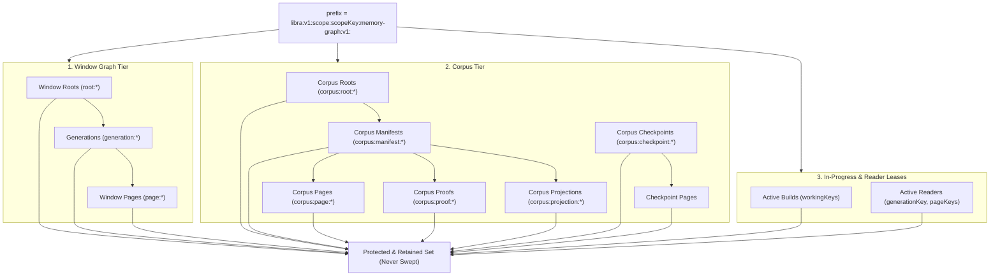

# LIBRA Storage Lifecycle & Namespace Fence GC Contract (N05)

**Document Version:** 1.0.0  
**Date:** 2026-10-15  
**Status:** Canonical Storage Lifecycle & GC Specification  
**Related Documents:**
- [`LIBRA_UNIFIED_MEMORY_ENGINE_NEXT_TASKS_20261014.md`](LIBRA_UNIFIED_MEMORY_ENGINE_NEXT_TASKS_20261014.md) (§8 N05)
- [`LIBRA_UNIFIED_MEMORY_ENGINE_STATUS_20261014.md`](LIBRA_UNIFIED_MEMORY_ENGINE_STATUS_20261014.md)
- [`LIBRA_UNIFIED_MEMORY_EVALUATION_CONTRACT_20261015.md`](LIBRA_UNIFIED_MEMORY_EVALUATION_CONTRACT_20261015.md)
- Core Implementation: [`PROGRAM/tools/libra_memory_graph_store.cjs`](../tools/libra_memory_graph_store.cjs)
- Embedded Kernel: [`PROGRAM/plugins/LIBRA.js`](../plugins/LIBRA.js)
- Test Suite: [`PROGRAM/tests/libra_memory_graph_store_lifecycle_gc_test.cjs`](../tests/libra_memory_graph_store_lifecycle_gc_test.cjs)

---

## 1. 개요 및 목적 (Overview & Purpose)

N05는 LIBRA 메모리 그래프 저장소의 **완전한 영속 인벤토리(Durable Inventory), 네임스페이스 펜스(Namespace Fence), 진행 중 빌드(In-progress Build) 및 리더 리스/핀(Reader Lease/Pin) 보호, 다계층 도달성(Multi-tier Reachability) 및 수명주기 가비지 컬렉션(GC)** 계약을 확정한다.

### 1.1 핵심 원칙
1. **증명 없는 삭제 차단 (Safe Blocked Deletion)**:
   - 스토리지 소유자가 원자적 네임스페이스 펜스(`inventory.fence`) 및 조건부 삭제(`deleteConditional`) 기능을 증명하지 못하는 경우, 실제 물리 삭제는 엄격히 `status: 'blocked_atomic_gc_unavailable'`로 차단되고 삭제 건수는 0건(`deletedKeys: []`)을 유지한다.
   - 드라이 런(`dryRun: true`)은 어떠한 경우에도 삭제 트랜스포트를 호출하지 않고 관찰 및 후보 진단만 수행한다.
2. **진행 중 빌드 보호 (In-progress Build Protection)**:
   - 빌드가 진행 중이어서 작업 페이지(working pages)가 이미 스토리지에 기록되었으나 아직 루트(`rootKey`)에 커밋되기 전인 과도기 자산은, 네임스페이스 펜스의 활성 빌드 레지스트리(`activeBuilds`)를 통해 GC 후보에서 제외되어 절대 삭제되지 않는다.
3. **활성 리더 핀/리스 보호 (Reader Lease/Pin Protection)**:
   - 새 루트가 발행되어 이전 세대(generation)가 루트 참조에서 분리되었더라도, 동시 실행 중인 리더가 해당 세대나 페이지에 핀/리스(`activeReaders`)를 보유하고 있는 경우 GC는 해당 데이터를 엄격히 보존한다.
4. **리스 만료 정책 (Lease Expiration & Reclamation)**:
   - 활성 리스/핀은 만료 시각(`expiresAtMs`)을 가지며, 리스가 만료(`nowMs > expiresAtMs`)되거나 명시적으로 해제된 경우에만 안전하게 고아 자산(orphan candidate)으로 편입되어 회수된다.
5. **다계층 도달성 보존 (Multi-tier Reachability)**:
   - 윈도우 그래프 스토어 GC는 코퍼스 자산(코퍼스 루트, 매니페스트, 증명, 투영, 페이지, 체크포인트) 및 표현(representation) 자산을 고아로 오인하여 청소하지 않는다. 모든 계층의 루트 및 체크포인트를 명시적으로 마킹하여 보존한다.
6. **동시성 경합 시 원자적 중단 (Atomic Conflict Abort)**:
   - 마크 단계 이후 조건부 삭제 직전 또는 도중에 다른 퍼블리셔가 루트를 변경하거나 후보 내용이 변조된 경우, `deleteConditional` 및 `verifyRootsUnchanged`가 이를 즉각 감지하고 `aborted_concurrent_mutation`으로 안전하게 중단한다.

---

## 2. 네임스페이스 펜스 및 인벤토리 규격 (Namespace Fence & Inventory Specification)

### 2.1 인벤토리 캡처 인터페이스
```javascript
const inventory = await owner.captureGCInventory(prefix);
// inventory schema: 'libra.storage_namespace_inventory.v1'
// {
//   keys: string[],
//   complete: true,
//   fence: {
//     fenceId: string,
//     epoch: number,
//     namespace: string,
//     issuedAtMs: number,
//     expiresAtMs: number,
//     activeBuilds: [{ id, workingKeys: string[], startedAtMs, expiresAtMs, cancelled }],
//     activeReaders: [{ id, generationKey: string, pageKeys: string[], acquiredAtMs, expiresAtMs, released }]
//   } | null
// }
```

### 2.2 조건부 삭제 인터페이스
```javascript
const removed = await owner.deleteConditional({
  key: candidateKey,
  expectedRaw: string,
  prefix: string,
  inventory: object,
  roots: [{ key, raw }],
  corpusRoots: [{ key, raw }],
  protectedKeys: string[],
  fence: object | string
});
```
- `deleteConditional`은 다음 조건을 원자적으로 검증한다:
  1. `roots` 및 `corpusRoots`의 현재 스토리지 값이 전달받은 `raw`와 일치함 (루트 불변성).
  2. `values.get(candidateKey) === expectedRaw` (후보 내용 불변성).
  3. `candidateKey`가 `protectedKeys`에 포함되지 않음 (빌드/리더 보호).
  4. 네임스페이스 펜스가 유효함.
- 위 조건 중 하나라도 위배되면 삭제 없이 즉시 `false`를 반환하여 GC를 `aborted_concurrent_mutation`으로 중단시킨다.

---

## 3. 다계층 자산 도달성 구조 (Multi-Tier Reachability Map)

GC 마크 단계는 단일 계층만 보지 않고 스코프 네임스페이스 전체의 활성 참조를 전수 탐색한다:



---

## 4. 검증 결과 및 계약 테스트 (Verification & Tests)

신규 구축된 전용 테스트 스위트 [`PROGRAM/tests/libra_memory_graph_store_lifecycle_gc_test.cjs`](../tests/libra_memory_graph_store_lifecycle_gc_test.cjs)를 통해 7대 핵심 불변식을 100% 검증했다:

1. **펜스 부재 시 삭제 차단**: `fence: null`인 경우 `blocked_atomic_gc_unavailable` 반환, 0건 삭제.
2. **불완전 인벤토리 거부**: `complete: false`인 경우 `blocked_incomplete_inventory` 반환, 0건 삭제.
3. **진행 중 빌드 보호**: 미커밋 작업 페이지는 후보에서 제외되어 완벽 보존.
4. **리더 리스 보호**: 만료되지 않은 리더 리스가 걸린 구세대 매니페스트/페이지는 보존.
5. **리스 만료 후 안전 회수**: 리스 만료(`nowMs > expiresAtMs`) 후 정상적으로 고아 후보 등록 및 조건부 삭제.
6. **다계층 도달성**: 코퍼스 루트, 매니페스트, 증명, 체크포인트 자산 보존.
7. **동시성 경합 방어**: 삭제 도중 동시 루트 변경 시 `aborted_concurrent_mutation`으로 안전 중단.

```bash
$ /usr/local/bin/node PROGRAM/tests/libra_memory_graph_store_lifecycle_gc_test.cjs
  ✓ N05: owner without namespace fence blocks deletion with blocked_atomic_gc_unavailable
  ✓ N05: incomplete inventory returns blocked_incomplete_inventory without deleting
  ✓ N05: in-progress builds protect uncommitted working pages from deletion
  ✓ N05: active reader lease protects unreferenced generation until lease expires
  ✓ N05: multi-tier reachability retains corpus roots, manifests, checkpoints, and proofs
  ✓ N05: concurrent mutation during delete phase aborts sweep without data loss
  ✓ N05: inspect exposes lifecycle protection and multi-tier reachability properties

All 7/7 N05 storage lifecycle and GC tests passed.
```
