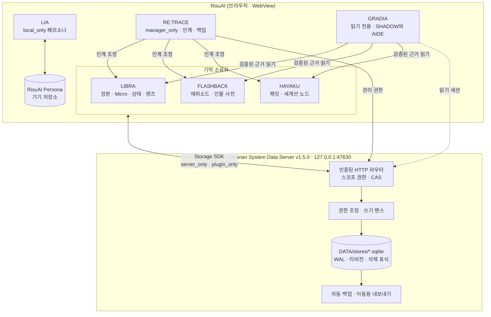

<p align="center">
  
</p>

<h1 align="center">Librarian System</h1>

<p align="center"><b>근거가 있는 기억만, 지금의 이야기에.</b></p>

<p align="center">
  &nbsp;
  &nbsp;
  &nbsp;
  &nbsp;
  &nbsp;
  
</p>

<p align="center">
  <a href="https://github.com/rusinus12-droid/Librarian-System"></a>
  <a href="https://nodejs.org/"></a>
  <a href="https://github.com/kwaroran/Risuai"></a>
  <a href="./LICENSE"></a>
</p>

Librarian System은 **RisuAI**를 위한 로컬 기억 인프라입니다. 로컬 서버 하나와 플러그인 여섯 개로 이루어져 있습니다.

목표는 기억을 많이 쌓는 것이 아닙니다. **원문 근거가 확인된 기억만 남기고, 그 기억을 지금의 대화에 정확히 잇는 것**입니다. 긴 채팅, 분기와 재생성이 잦은 채팅에서도 기억이 섞이거나 근거 없는 요약이 끼어들지 않게 합니다.

---

## 한 서고, 여섯 개의 역할

| | 플러그인 | 맡은 일 |
| :---: | :--- | :--- |
|  | **LIBRA** · 장기 서사 기억 | 원문 근거로 검증한 것만 정본으로 남기고, 지금의 인물·세계·관계 상태로 투영합니다. |
|  | **FLASHBACK** · 에피소드 회상 | 지나간 장면을 원문째 다시 꺼내 지금의 대화에 비춥니다. |
|  | **HAYAKU** · 시공간 연속성 | 누가, 어디에, 언제 있는지를 턴마다 이어 붙입니다. |
|  | **LIA** · 페르소나 링커 | 이 기기 안에서 페르소나를 만들고 다듬어 채팅에 연결합니다. |
|  | **RE:TRACE** · 인계와 보관 | 다음 세션 인계, 백업과 복원, 스코프 관리를 맡습니다. |
|  | **GRADIA** · 서사 보조 | 세 기억을 읽기만 하고, AIDE 단계를 거치며 응답 초안을 다듬습니다. |

기억을 **소유**하는 것은 LIBRA·FLASHBACK·HAYAKU 셋입니다. LIA는 이 기기에만 페르소나를 보관하고, RE:TRACE는 세 소유자 사이의 인계와 관리를 조정합니다. GRADIA는 어떤 기억도 쓰지 않는 읽기 전용 소비자입니다.

---

## 설계 원칙

**근거가 먼저입니다.** 모든 기억은 그 기억이 나온 원문 메시지와 묶여 있습니다. 원문이 바뀌면 그 기억은 다시 확인되기 전까지 지금의 근거로 쓰이지 않습니다.

**세계선은 섞이지 않습니다.** 채팅 분기, 재생성, 롤백이 일어나면 스코프와 리비전 경계로 각 세계선의 기억을 따로 추적합니다. 다른 세계선의 기억이 지금의 대화에 들어오지 않습니다.

**필터는 "보지 마"이지 "바뀌었다"가 아닙니다.** 원문 태그 필터를 추가하거나 고쳐도 기존 기억은 무효가 되지 않습니다. 저장본과 현재본을 모두 지금의 필터로 읽어 비교하고, 필터가 보는 부분이 실제로 바뀐 경우에만 원문 변경으로 판단합니다. ([원문 태그 필터 원칙](./PROGRAM/docs/SOURCE_TAG_FILTER_PRINCIPLE_20261119.md))

**실패는 그 부분만 막습니다.** 상태 투영에서 한 항목을 적용하지 못하면 그 항목만 보류하고 나머지는 반영합니다. 모델 문맥이 부족하면 출력 예약, 공유 참조, 부가 지시 순으로 덜어 내며 턴을 끝까지 진행합니다.

**로컬에 남습니다.** 데이터는 이 기기의 `DATA/` 폴더나 RisuAI 브라우저 저장소에만 있습니다. 서버는 기본적으로 loopback(`127.0.0.1`)에서만 열리고, 외부 데이터베이스나 클라우드 서비스가 필요하지 않습니다.

---

## 구조



한 턴은 이렇게 흐릅니다.

1. 응답이 끝나면 소유자 플러그인이 그 턴의 원문(U+A)을 영수증으로 남기고 기억 후보를 만듭니다.
2. 저장소(서버의 SQLite 또는 플러그인 저장소)가 스코프·리비전·CAS 규칙으로 쓰기를 검증합니다.
3. 다음 요청 직전, 원문과 아직 맞는 기억만 골라 공통 예산 안에서 프롬프트에 넣습니다.

---

## 구성 컴포넌트 (v1.5.0 기준)

| 컴포넌트 | 버전 | 구분 | 주요 역할 |
| :--- | :---: | :---: | :--- |
| **Librarian System Server** | `1.5.0` | 로컬 서버 | Node.js 내장 SQLite(WAL) 저장소, 스코프 카탈로그, 읽기 세션, 자동 백업과 무결성 검증 |
| **LIBRA** | `3.2.1` | 기억 소유자 | 5턴 정본과 매 턴 Micro, 상태 투영, 사용자 렌즈, 이야기 시계, 하이브리드 회상 |
| **Flashback Memory** | `2.2.2` | 기억 소유자 | 턴 단위 에피소드 저장, 벡터·키워드 회상, 인물 사전, 확인 후 실행하는 유지보수 |
| **HAYAKU Locator Continuity** | `4.2.2` | 기억 소유자 | 응답에 담긴 상태 패킷, 세계선 노드, 위치·인물 배치 연속성, 누락 복구 |
| **LIA Persona Linker** | `0.32.0` | 기기 전용 | 페르소나 생성(4가지 방식)·편집·번역, 이미지 에셋, 라이브러리 저장, 채팅 연결 |
| **RE:TRACE** | `2.2.0` | 관리자 | 다음 세션 인계, 소유자별 결과 확인, 백업·복원·초기화, 서버 스코프 관리 |
| **GRADIA** | `1.3.0` | 읽기 전용 소비자 | SHADOW 초안과 인물·세계관·플롯 AIDE, 확장 AIDE, 소설·RP 모드 |

> 호환 SDK: Storage SDK `1.8.35` · Compute SDK `0.3.8`

---

## 플러그인

###  LIBRA · 장기 서사 기억

정본의 사서입니다. 대화를 원문 근거와 함께 기록하고, 그 근거가 유지되는 동안만 기억으로 씁니다.

- **완료 턴 영수증:** 응답이 끝날 때마다 그 턴의 사용자 입력과 응답 원문을 변경할 수 없는 영수증으로 남깁니다. 이후의 모든 기억은 이 영수증에 묶입니다.
- **Micro와 정본:** 매 턴 Micro 기억(사건·변화·인물 후보)을 만들고, 5턴마다 그 구간을 종합해 정본(Canonical) 기억으로 확정합니다.
- **상태 투영:** 정본과 그 뒤의 Micro를 합쳐 지금의 인물·세계·관계·서사 상태(State)를 만듭니다. 적용하지 못한 항목만 보류하고, 사용자가 기억 검토에서 승인하거나 거절할 수 있습니다.
- **렌즈와 이야기 시계:** 몸 상태, 약속처럼 사용자가 정한 관점의 렌즈 노트를 따로 기록하고, 이야기 속 시간을 이어서 셉니다.
- **회상:** 의미 검색과 어휘 검색을 함께 써서 지금의 입력에 맞는 기억을 고르고, 다른 두 소유자와 공통 예산을 나눠 씁니다. 이미 화면에 보이는 최근 턴은 회상에서 뺍니다.
- **원문 재분석:** 원문을 고쳤거나 다시 분석하고 싶은 구간을 직접 골라 정본·Micro·렌즈를 다시 만듭니다.

###  FLASHBACK · 에피소드 회상

그 장면을 다시 꺼냅니다. 요약하지 않고 턴의 원문을 그대로 보관했다가, 지금의 대화와 닿는 장면을 돌려줍니다.

- **턴 단위 보관:** 사용자 입력과 응답을 한 턴으로 묶어 원문째 저장하고, 응답 원문 보관함(필름 보관함)에서 확인할 수 있습니다.
- **회상:** 임베딩 벡터와 키워드를 함께 써서 관련 장면을 찾습니다.
- **인물 사전:** 대화에 등장한 인물을 모아 회상 패널과 상단 메뉴에서 찾아볼 수 있습니다.
- **유지보수:** 누락, 변경, 원문 태그 규칙 반영처럼 다시 정리할 턴과 예상 비용을 먼저 보여 주고, 확인한 뒤에만 실행합니다.

###  HAYAKU · 시공간 연속성

누가, 어디에, 언제 있는지를 놓치지 않습니다.

- **상태 패킷:** 응답 안에 숨겨진 상태 패킷으로 장소, 시간, 인물 배치를 기록합니다. 패킷은 원문 태그 필터의 대상이 아니라서, 필터를 바꿔도 기록이 끊기지 않습니다.
- **세계선 노드:** 턴마다 노드를 두고 분기, 재생성, 롤백을 구분합니다. 다른 노드의 기록은 지금의 턴에 묶이지 않습니다.
- **복구:** 놓친 턴을 찾아 Cold Start, 누락 복구, 실패 기록 정리로 채웁니다. 실행 전에 대상 턴과 예상 호출 수를 보여 줍니다.

###  LIA · 페르소나 링커

나를 이야기에 잇습니다. 모든 자료는 이 기기에만 저장하고(`local_only`), 서버를 쓰지 않습니다.

- **생성:** 기본, 무작위, 캐릭터에서 추출, 사용자가 쓴 대화에서 추출의 네 가지 방식으로 페르소나 후보를 만듭니다.
- **편집:** 23개 항목을 원문과 번역으로 따로 다루고, 고정한 항목은 다시 생성해도 바뀌지 않습니다.
- **에셋과 라이브러리:** 기본 표정과 감정별 이미지를 만들고, 결과를 기기 라이브러리에 저장하거나 RisuAI 페르소나로 채택합니다.
- **채팅 연결:** 채팅마다 페르소나를 연결하고, 사용자가 실행할 때만 최근 다섯 턴이나 전체 대화를 검토해 변화를 제안합니다.
- **로어 정렬:** 월드 로어북 항목을 지금의 대화에 맞게 BM25F 방식으로 다시 정렬합니다.

###  RE:TRACE · 인계와 보관

길을 거슬러 잇습니다. 기억을 직접 만들지 않고, 세 소유자의 기억이 안전하게 옮겨지도록 조정합니다.

- **다음 세션 인계:** 긴 채팅을 새 채팅으로 이어 갈 때 LIBRA·FLASHBACK·HAYAKU의 기억을 원본 그대로 옮기고, 소유자마다 결과를 교차 확인합니다. LIA의 페르소나 연결도 함께 이어집니다.
- **백업과 복원:** 서버와 플러그인 스코프를 ZIP으로 내보내고 되돌립니다. 결과를 알 수 없는 작업은 보호된 상태로 남깁니다.
- **스코프 관리:** 서버와 기기의 스코프를 한 화면에서 보고, 고정(Pin)과 삭제 보호를 관리합니다.

###  GRADIA · 서사 보조

한 단계씩 다듬는 초안입니다. 세 소유자의 검증된 근거를 읽기만 하고, 어떤 기억도 쓰지 않습니다.

- **파이프라인:** SHADOW가 첫 초안을 쓰고, 인물·세계관·플롯 AIDE가 차례로 점검하고 고칩니다. 소설 모드와 RP 모드는 서로 다른 규칙을 따르며, RP에서는 페르소나의 행동을 대신 정하지 않습니다.
- **확장 AIDE:** 상태(몸 상태), 억결(관계 형성), 세계 동역학(장면 밖의 움직임), 관계 시뮬레이터, 정사 AIDE를 필요에 따라 켭니다. 확장 AIDE는 상위 AIDE의 하위 단계로 실행됩니다.
- **장면 연속성:** 의상, 물건, 인물의 자세와 위치를 상태로 다루어, 보이는 행동 없이 바뀌지 않게 합니다. NPC 반응 경향성과 이번 턴의 변수도 장면 안에서만 작동합니다.
- **근거 읽기:** 플러그인 IPC 또는 서버 읽기 세션으로 근거를 가져오고, 쓰기 직전에 그 근거가 아직 유효한지 다시 확인합니다.
- **문맥 예산:** 모델 문맥이 부족하면 출력 예약, 공유 참조, NPC 경향성 설명, 이번 턴 변수 순으로 덜어 내고, 무엇을 덜었는지 결과에 남깁니다.

---

## 시작하기

### 1. 준비

> [!IMPORTANT]
> 배포 ZIP에는 Node.js가 들어 있지 않습니다. 서버를 실행하기 전에 **Node.js `22.13.0` 이상**(LTS 권장)을 설치하세요. 서버는 Node.js 내장 `node:sqlite`를 씁니다.
> - 공식 다운로드: [nodejs.org](https://nodejs.org/)
> - Android Termux: 먼저 `sh "PROGRAM/안드로이드_Termux_준비.sh"`로 환경을 준비하세요.

### 2. 서버 실행

패키지를 원하는 폴더에 풀고, 운영체제에 맞는 스크립트를 실행합니다.

| 운영체제 | 실행 | 백그라운드 실행 | 종료 | 상태 확인 |
| :--- | :--- | :--- | :--- | :--- |
| **Windows** | `PROGRAM\1_서버_실행.bat` | `PROGRAM\서버_백그라운드_실행.bat` | `PROGRAM\2_서버_종료.bat` | `PROGRAM\서버_상태_확인.bat` |
| **macOS** | `PROGRAM/macOS_서버_실행.command` | `PROGRAM/서버_백그라운드_실행.sh` | `PROGRAM/2_서버_종료.sh` | `PROGRAM/서버_상태_확인.sh` |
| **Linux · Termux** | `PROGRAM/1_서버_실행.sh` | `PROGRAM/서버_백그라운드_실행.sh` | `PROGRAM/2_서버_종료.sh` | `PROGRAM/서버_상태_확인.sh` |

- 기본 주소는 `http://127.0.0.1:47630`이며 이 기기에서만 접속할 수 있습니다.
- **포트 바꾸기:** 47630 포트를 다른 프로그램이 쓰고 있다면, 서버를 끈 상태에서 `PROGRAM\서버_포트_변경.bat` 또는 `sh PROGRAM/서버_포트_변경.sh`로 바꿉니다.
  - 도구가 서버가 꺼졌는지와 새 포트가 비어 있는지 확인한 뒤 `DATA/config/server-config.json`에 저장합니다.
  - 플러그인은 서버 주소를 각자 저장하므로, 플러그인마다 새 주소로 바꿔 주세요. 위치는 LIBRA·HAYAKU·FLASHBACK은 서버 연결 설정, GRADIA는 소스 탭, RE:TRACE는 서버 관리 → 연결 진단입니다. LIA는 서버를 쓰지 않습니다.
  - 자세한 내용: [사용설명서](./PROGRAM/docs/사용설명서.md)의 '서버 포트 바꾸기'
- **Docker:** 패키지 폴더에서 `docker compose -f PROGRAM/docker/compose.yaml up -d --build`로 실행합니다. 플러그인 주소는 그대로 두고, 첫 실행 로그에 나온 **접근 키**를 넣습니다.
- **다른 기기에서 쓰기:** `PROGRAM\서버_외부접속_설정.bat` 또는 `sh PROGRAM/서버_외부접속_설정.sh`로 원격 접속 모드를 켜고, Tailscale이나 Cloudflare Tunnel의 `https://` 주소로 연결합니다. Tailscale은 `서버_원격접속_열기` 도구가 열고 닫습니다. 원격 접속 모드에서는 이 PC의 플러그인도 접근 키가 필요합니다. 자세한 내용: [서버 사용과 접속 관련 상세 안내](./PROGRAM/서버_사용과_접속_관련_상세_안내.txt)

### 3. 플러그인 설치

1. RisuAI에서 **설정 → 플러그인**으로 이동합니다.
2. [`PROGRAM/plugins/`](./PROGRAM/plugins)의 플러그인 파일을 등록합니다.
   - `LIBRA.js` · `Flashback_Memory.js` · `HAYAKU_Locator_Continuity.js`
   - `LIA_Persona_Linker.js` · `RETRACE.js` · `GRADIA.js`
3. LIBRA·HAYAKU·FLASHBACK의 서버 연결 설정에서 `http://127.0.0.1:47630`에 연결하고 저장 모드를 고릅니다.

### 4. RisuAI HypaV3 끄기

LIBRA·HAYAKU·FLASHBACK을 쓰는 채팅에서는 **RisuAI의 HypaV3(장기 기억 요약)를 끄는 것을 기준으로 합니다.** 지난 대화의 기억은 세 플러그인이 맡습니다.

- **끄는 이유:**
  - HypaV3 요약은 원문 근거 없이 다시 쓴 문장이라, 원문을 고쳐도 갱신되지 않습니다.
  - 요약이 실패하면 메시지 전송이 멈춥니다.
  - 플러그인 기억과 함께 쓰면 같은 과거가 두 번 들어갑니다.
- **끄는 순서:** 이미 긴 채팅이라면 먼저 각 플러그인의 과거 기억이 준비됐는지 확인한 뒤 끄세요. 확인할 것은 LIBRA 분석, FLASHBACK 현재 채팅 가져오기 등입니다. 채팅에 저장된 HypaV3 요약은 지워지지 않습니다.
- **임시로 켜도 되는 경우:** 플러그인 기억이 아직 준비되지 않은 긴 채팅이라면 HypaV3의 메모리 비율(`memoryTokensRatio`)을 낮게 잡고 켜 두세요.

자세한 근거: [HypaV3를 끄고 LIB로 기억을 맡기는 기준](./PROGRAM/docs/HYPAV3_RETIREMENT_POLICY_20261119.md)

---

## 기억을 다루는 설정

### 저장 모드

| 모드 | 저장 위치 | 쓰임 |
| :--- | :--- | :--- |
| **`server_only`** (권장) | 로컬 서버의 `DATA/` SQLite | 브라우저 용량 제한이 없고, 자동 백업·스냅샷 복원·정합성 검증을 모두 지원합니다. |
| **`plugin_only`** | RisuAI 브라우저 저장소 | 서버 없이 플러그인 안의 저장소와 연산만 씁니다. |
| `mirror` | 두 저장 위치 | 예전 설정을 옮기는 전환 단계로만 남아 있습니다. 새 설정에서는 두 단독 모드 중 하나를 쓰세요. |

### 기억 주입 공통 예산

세 소유자가 프롬프트에 넣을 기억의 총량과 비율을 한곳에서 정합니다. 같은 내용을 여러 플러그인이 넣으면 한 번만 남깁니다. ([기억 주입 공통 예산과 중복 제거](./PROGRAM/docs/MEMORY_SUITE_RECALL_SHARE_20261119.md))

### 원문 태그 필터

상태창, 삽화, 번역 표식처럼 분석에서 뺄 태그와 표식을 정합니다.

- 각 플러그인의 메인 화면에서 열고, 세 소유자에게 같은 규칙을 함께 적용할 수 있습니다.
- 필터를 바꿔도 기존 기억은 그대로 유효합니다.
- 필터를 바꾼 뒤 지금의 규칙으로 다시 분석할지는 사용자가 원문 재분석이나 유지보수에서 직접 고릅니다.

### OOC 모드와 온디맨드 기억 조회 (Leave 프리셋)

[Leave 프리셋](./PROGRAM/prompt/Leave_RisuAI_Preset.json)의 `📖 I. 서사 집필실`에서 **OOC 모드**(`방랑 사서 리브` 또는 `담백한 어시스턴트`)를 켜면 LIBRA·HAYAKU·FLASHBACK의 분석·저장과 GRADIA의 초안 파이프라인이 자동으로 멈춥니다. OOC 응답은 `<ooc>...</ooc>` 카드로 표시되며, 이후 정상 서사 턴에서도 기억 분석 대상에서 제외됩니다.

과거 기록 확인이 필요할 때만 질문 맨 앞에 아래 접두사를 붙이면, 지정한 플러그인만 **읽기 전용**으로 기억을 조회해 답변 근거를 제공합니다(쓰기·저장·상태 패킷 계약 주입은 실행되지 않습니다).

| 접두사 (별칭) | 조회 대상 |
| :--- | :--- |
| **`@기억`** (`@memory`, `@전체`, `@all`, `@lib`) | LIBRA + HAYAKU + FLASHBACK 전체 조회 |
| **`@리브라`** (`@libra`) | LIBRA 정본·Micro·스토리 클락만 조회 |
| **`@하야쿠`** (`@hayaku`) | HAYAKU 시공간 원장·과거 타임라인 노드만 조회 |
| **`@플래시백`** (`@flashback`, `@fb`) | FLASHBACK 에피소드 원문 회상만 조회 |

- 복수 지정 가능: `@리브라 @하야쿠 예전에 아린이랑 푸딩이 첫키스한 날짜가 어떻게 되지?`
- 전체 조회 예시: `@기억 예전에 아린이랑 푸딩이 첫키스한 날짜가 어떻게 되지?`

---

## 업데이트와 데이터 안전

명령어를 입력할 필요 없이 최상위 폴더의 업데이트 실행 파일을 실행하세요.

- **Windows**: `업데이트.bat`
- **macOS**: `업데이트.command`
- **Linux · Termux**: `업데이트.sh`

```text
[업데이트 메뉴]
1. 이 폴더의 서버를 최신 버전으로 업데이트
2. 다른 기존 설치 폴더를 업데이트
3. 미완료 업데이트 복구
```

> [!WARNING]
> - **새 배포판의 빈 `DATA` 폴더를 기존 `DATA` 위에 덮어쓰지 마세요.** 업데이터(`UPDATER`)가 기존 `DATA`를 보존하고 필요하면 마이그레이션합니다.
> - 업데이트가 중간에 멈췄다면 메뉴의 **`3. 미완료 업데이트 복구`**로 이전 `PROGRAM`·`DATA` 쌍으로 되돌립니다.
> - 업데이터는 RisuAI 안에 이미 로드된 플러그인을 바꾸지 못합니다. 플러그인 버전이 바뀌었다면 `PROGRAM/plugins/`의 최신 파일을 RisuAI에 다시 등록하세요.

---

## 폴더 구조

```text
Librarian-System/
├── 0_설치_안내.txt               # 설치와 업데이트 안내
├── 업데이트.bat / .command / .sh # 대화형 업데이터
├── update-manifest.json          # 릴리스 버전과 에셋 무결성 매니페스트
├── SHA256SUMS.txt                # 배포 파일 SHA-256 목록
├── DATA/                         # 사용자 데이터: DB, 설정, 백업, 로그 (덮어쓰기 금지)
├── UPDATER/                      # 트랜잭션 기반 업데이트와 롤백
└── PROGRAM/                      # 실행 프로그램
    ├── 1_서버_실행.* · 2_서버_종료.*
    ├── program-manifest.json     # 플러그인·SDK 버전과 파일 해시
    ├── server/                   # 로컬 서버 (server.cjs, 권한, 이동용 내보내기)
    ├── plugins/                  # RisuAI에 등록할 플러그인 6종
    ├── sdk/                      # Storage SDK · Compute SDK 원본
    ├── tools/                    # 런처, 데이터 준비, 배포 빌드 도구
    ├── tests/                    # 단위·통합·브라우저·회귀 테스트
    └── docs/                     # 설계 문서, 검증 보고서, 브랜드(docs/brand)
```

---

## 개발과 테스트

```bash
# Node.js 런타임과 SQLite 지원 확인
node PROGRAM/tools/check_node.cjs

# 데이터 폴더 준비와 레이아웃 검증
node PROGRAM/tools/platform_launcher.cjs prepare

# 전체 회귀 테스트 (Linux · macOS)
sh PROGRAM/관리도구/전체_자동시험.sh

# 메타데이터와 패키지 레이아웃 일관성
node PROGRAM/tests/program_data_layout_test.cjs
node PROGRAM/tests/distribution_metadata_coherence_test.cjs

# 회귀 배치
python3 PROGRAM/run_regression_batch.py
```

릴리스 전에는 GitHub Actions의 **Release Builder Gate**(배포 빌드, 스모크 테스트, 플러그인 회귀)와 **RisuAI Compatibility Gate**(고정된 RisuAI 원본 기준 플러그인 계약 검사)를 통과해야 합니다.

---

## 브랜드

심볼, 색, 글꼴의 기준은 [Librarian Suite CI](./PROGRAM/docs/brand/README.md)에 있습니다.

모든 심볼은 같은 골격(48 그리드, 둥근 선, 타일 모서리 25%) 위에 색 하나와 기호 하나를 얹습니다. 플러그인 GUI는 각자의 테마를 유지하고, 로고 타일과 글꼴로 한 가족임을 나타냅니다.

## 라이선스

이 프로젝트는 **[GNU Affero General Public License v3.0](./LICENSE)**으로 배포됩니다. GUI에 내장한 Space Grotesk와 IBM Plex Mono는 SIL Open Font License 1.1을 따릅니다.
