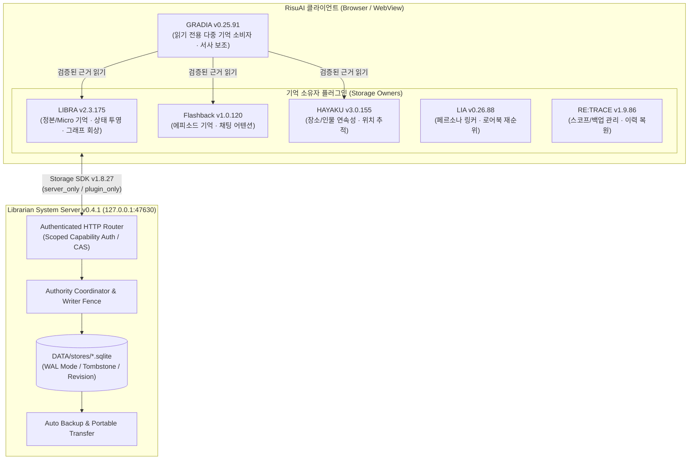

# 📚 Librarian System

[](https://github.com/rusinus12-droid/Librarian-System)
[](https://nodejs.org/)
[](https://github.com/kwaroran/RisuAI)
[](./LICENSE)

**Librarian System**은 **RisuAI** 환경을 위해 설계된 로컬 백엔드 데이터 서버 및 6종의 지능형 메모리·서사 연속성 플러그인 스위트입니다.  
단순 요약이나 키워드 매칭을 넘어, **원문 근거 검증(Source-Bound Proof)**, **분기/월드라인(Worldline) 격리**, **실시간 상태 투영(State Projection)**, 그리고 **트랜잭션 기반의 영구 데이터 보존**을 제공합니다.

---

## ✨ 핵심 특징

- **🔗 6종 플러그인 생태계**: 장기 서사 기억(`LIBRA`), 에피소드 회상(`Flashback`), 시공간/위치 연속성(`HAYAKU`), 페르소나·로어 링킹(`LIA`), 스코프·백업 관리(`RE:TRACE`), 다중 기억 기반 서사 보조(`GRADIA`)로 구성된 통합 아키텍처.
- **🛡️ 무결성 중심의 로컬 서버 (`node:sqlite`)**: 외부 데이터베이스 설치 없이 Node.js 내장 SQLite(WAL 모드)를 사용하여 CAS(Compare-And-Swap) 리비전 관리, 암호화 해시 검증, 자동 백업 및 복구를 수행합니다.
- **🌿 네이티브 분기(Worldline) 완벽 대응**: 채팅 분기, 재생성(Reroll), 이어하기 발생 시 이전 세계선의 기억이 섞이지 않도록 스코프와 리비전 경계를 엄격하게 분리·추적합니다.
- **📦 코드(`PROGRAM`)와 데이터(`DATA`)의 완전한 분리**: 업데이트 중 오류가 발생해도 기존 `DATA`를 보호하며, 저널 기반 자동 롤백(`UPDATER`)을 지원합니다.
- **💻 크로스 플랫폼 지원**: Windows(`.bat`), macOS(`.command`), Linux 및 Android Termux(`.sh`) 원클릭 런처를 기본 제공합니다.

---

## 🧩 시스템 아키텍처



---

## 📦 구성 컴포넌트 (v0.4.1 기준)

| 컴포넌트 | 버전 | 구분 | 주요 역할 |
| :--- | :---: | :---: | :--- |
| **Librarian System Server** | `0.4.1` | 로컬 서버 | SQLite 기반 KV/그래프 저장소, 스코프 카탈로그, 자동 백업 및 무결성 검증 서버 |
| **LIBRA** | `2.3.175` | 플러그인 (Owner) | 5턴 정본(Canonical) + 매 턴 Micro 기억 추출, 현재 상태(State Head) 투영, 시맨틱/어휘 하이브리드 회상 |
| **Flashback Memory** | `1.0.120` | 플러그인 (Owner) | 대화 맥락 장기 에피소드 기억, 벡터/키워드 검색, 제로터치 채팅 어텐션 버튼 |
| **HAYAKU Locator Continuity** | `3.0.155` | 플러그인 (Owner) | 장면 전환·장소 이동·인물 배치 연속성 추적 및 빠른 위치 컨텍스트 복원 |
| **LIA Persona Linker** | `0.26.88` | 플러그인 (Owner) | 페르소나 상태 델타 추적 및 월드 로어북(Lorebook) BM25F 재순위화 |
| **RE:TRACE** | `1.9.86` | 플러그인 (Owner) | 서버/로컬 스코프 통합 조회, 고정(Pin), 삭제 보호, ZIP 백업 내보내기/복원 관리 GUI |
| **GRADIA** | `0.25.91` | 플러그인 (Consumer) | `LIBRA`·`Flashback`·`HAYAKU`의 검증된 기억 근거를 읽기 전용으로 통합 소비하는 소설/서사 생성 보조기 |

> **호환 SDK**: Storage SDK `1.8.27` · Compute SDK `0.3.8`

---

## 🚀 시작하기 (Quick Start)

### 1. 사전 요구사항 (필수)

> [!IMPORTANT]
> 일반 배포 ZIP에는 Node.js 실행 파일이 포함되어 있지 않습니다.  
> 서버 실행 전 반드시 **Node.js `22.13.0` 이상** (현재 LTS 버전 권장)을 설치해야 합니다 (`node:sqlite` 내장 모듈 사용).
> - 공식 다운로드: [https://nodejs.org/](https://nodejs.org/)
> - Android Termux 환경: 먼저 `sh "PROGRAM/안드로이드_Termux_준비.sh"`를 실행하여 환경을 구성하세요.

### 2. 서버 실행

원하는 폴더에 패키지를 압축 해제한 뒤, 운영체제에 맞는 실행 스크립트를 더블클릭하거나 터미널에서 실행합니다.

| 운영체제 | 포그라운드 실행 | 백그라운드 실행 | 서버 종료 | 상태 확인 |
| :--- | :--- | :--- | :--- | :--- |
| **Windows** | `PROGRAM\1_서버_실행.bat` | `PROGRAM\서버_백그라운드_실행.bat` | `PROGRAM\2_서버_종료.bat` | `PROGRAM\서버_상태_확인.bat` |
| **macOS** | `PROGRAM/macOS_서버_실행.command` | `PROGRAM/서버_백그라운드_실행.sh` | `PROGRAM/2_서버_종료.sh` | `PROGRAM/서버_상태_확인.sh` |
| **Linux / Termux** | `PROGRAM/1_서버_실행.sh` | `PROGRAM/서버_백그라운드_실행.sh` | `PROGRAM/2_서버_종료.sh` | `PROGRAM/서버_상태_확인.sh` |

- 기본 바인딩 주소는 `http://127.0.0.1:47630` (Loopback 전용)입니다.

### 3. RisuAI 플러그인 설치 및 연결

1. RisuAI 실행 후 **설정(Settings) → 플러그인(Plugins)** 메뉴로 이동합니다.
2. [`PROGRAM/plugins/`](./PROGRAM/plugins) 폴더 내에 있는 필요한 플러그인(`.js`) 파일들을 등록합니다:
   - `LIBRA.js`
   - `Flashback_Memory.js`
   - `HAYAKU_Locator_Continuity.js`
   - `LIA_Persona_Linker.js`
   - `RETRACE.js`
   - `GRADIA.js`
3. 각 플러그인의 **서버 연결 설정**에서 Librarian System Server(`http://127.0.0.1:47630`)에 연결하고 저장 모드를 선택합니다.

---

## 💾 저장 모드 안내 (Storage Modes)

Librarian System은 두 가지 정식 저장 모드와 한 가지 이관용 전환 모드를 제공합니다.

1. **`server_only` (서버 단독 - 권장)**
   - 모든 기억과 인덱스를 로컬 서버(`DATA/`)의 SQLite DB에 안전하게 저장합니다.
   - 브라우저 용량 제한이 없으며, 자동 백업·스냅샷 복원·정합성 검증을 완벽히 지원합니다.
2. **`plugin_only` (플러그인 단독)**
   - 서버 없이 RisuAI 브라우저 내부 저장소(`pluginStorage` / IndexedDB)와 로컬 JS 연산만 사용합니다.
3. **`mirror` (전환 단계)**
   - `plugin_only`와 `server_only` 사이에서 데이터를 안전하게 이관하기 위한 과도기 모드입니다. 이관이 완료되면 단독 모드로 전환하세요.

---

## 🔄 업데이트 및 데이터 안전 가이드

### 기존 사용자 업데이트 방법
명령어를 직접 입력할 필요 없이 최상위 폴더의 업데이트 실행 파일을 실행하세요.
- **Windows**: `업데이트.bat`
- **macOS**: `업데이트.command`
- **Linux / Termux**: `업데이트.sh`

```text
[업데이트 메뉴]
1. 이 폴더의 서버를 최신 버전으로 업데이트
2. 다른 기존 설치 폴더를 업데이트
3. 미완료 업데이트 복구
```

> [!WARNING]
> **데이터 보호 주의사항**
> - **절대 새 배포판의 빈 `DATA` 폴더를 기존 `DATA` 폴더 위에 수동으로 덮어쓰지 마세요.**
> - 업데이터(`UPDATER`)가 기존 `DATA`를 자동으로 보존하고, 필요한 경우 안전하게 마이그레이션합니다.
> - 업데이트 도중 예기치 않게 중단된 경우, 업데이트 메뉴의 **`3. 미완료 업데이트 복구`**를 실행하면 이전 `PROGRAM`/`DATA` 쌍으로 안전하게 롤백됩니다.
> - 서버 업데이터는 RisuAI 앱 내부에 로드된 플러그인을 자동 교체할 수 없으므로, 플러그인 버전이 변경된 경우 `PROGRAM/plugins/`의 최신 `.js` 파일을 RisuAI에 다시 적용해 주세요.

---

## 📂 디렉토리 구조

```text
Librarian-System/
├── 0_설치_안내.txt               # 빠른 설치 및 업데이트 안내문
├── 업데이트.bat / .command / .sh # 크로스 플랫폼 대화형 업데이터 런처
├── update-manifest.json          # 릴리스 버전 및 에셋 무결성 매니페스트
├── SHA256SUMS.txt                # 전체 배포 파일 SHA-256 체크섬 목록
├── DATA/                         # [사용자 데이터 영역] DB, 설정, 백업, 로그 (수동 덮어쓰기 금지)
├── UPDATER/                      # 트랜잭션 기반 자동 업데이트 및 롤백 엔진
└── PROGRAM/                      # [실행 프로그램 영역]
    ├── 1_서버_실행.*             # OS별 서버 구동 스크립트
    ├── 2_서버_종료.*             # OS별 서버 안전 종료 스크립트
    ├── program-manifest.json     # 플러그인/SDK 버전 및 파일 해시 명세
    ├── server/                   # Node.js 로컬 서버 코어 (server.cjs, authority, portable 등)
    ├── plugins/                  # RisuAI 설치용 6종 플러그인 번들 (.js)
    ├── sdk/                      # Storage SDK 및 Compute SDK 소스
    ├── tools/                    # 런처, 데이터 준비, RAG 평가, 배포 빌드 도구
    ├── tests/                    # 단위·통합·브라우저·회귀 테스트 스위트
    └── docs/                     # 아키텍처 설계 계약서 및 릴리스 검증 보고서
```

---

## 🛠️ 개발 및 테스트 (Development)

```bash
# Node.js 런타임 및 SQLite 지원 여부 확인
node PROGRAM/tools/check_node.cjs

# 데이터 폴더 초기화 및 레이아웃 검증
node PROGRAM/tools/platform_launcher.cjs prepare

# 메타데이터 및 패키지 레이아웃 일관성 테스트
node PROGRAM/tests/program_data_layout_test.cjs
node PROGRAM/tests/distribution_metadata_coherence_test.cjs

# 전체 회귀 배치 테스트 실행
python3 PROGRAM/run_regression_batch.py
```

---

## 📄 라이선스 (License)

이 프로젝트는 **[GNU Affero General Public License v3.0 (AGPL-3.0)](./LICENSE)** 라이선스 하에 배포됩니다.
