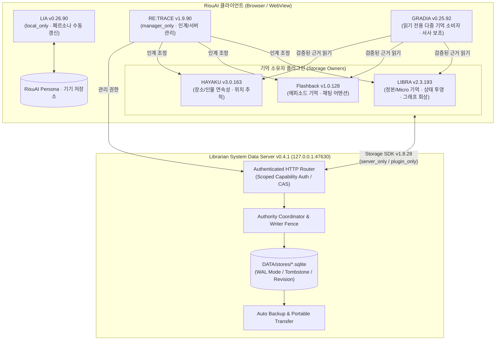

# 📚 Librarian System

[](https://github.com/rusinus12-droid/Librarian-System)
[](https://nodejs.org/)
[](https://github.com/kwaroran/RisuAI)
[](./LICENSE)

**Librarian System**은 **RisuAI**에서 장기 기억과 서사 연속성을 안정적으로 관리하기 위한 **로컬 서버 + 플러그인 스위트**입니다.
핵심 목표는 "기억을 많이 저장"하는 것이 아니라, **근거가 검증된 기억만 안전하게 보존하고 현재 대화에 정확히 연결**하는 것입니다.

## 🧭 프로젝트 한눈에 보기 (TL;DR)

| 항목 | 내용 |
| :--- | :--- |
| **무엇인가요?** | RisuAI용 로컬 메모리 인프라입니다. 서버(`Librarian System Server`)와 6개 플러그인(`LIBRA`, `Flashback`, `HAYAKU`, `LIA`, `RE:TRACE`, `GRADIA`)으로 구성됩니다. |
| **왜 필요한가요?** | 긴 대화/분기형 대화에서 기억 혼합, 근거 없는 요약, 상태 불일치 문제를 줄이기 위해서입니다. |
| **무엇이 다른가요?** | `Source-Bound Proof`(원문 근거 검증), `Worldline`(분기 격리), `State Projection`(현재 상태 투영), `CAS + SQLite WAL`(무결성 중심 저장)을 제공합니다. |
| **어떻게 시작하나요?** | ① Node.js 설치 → ② 서버 실행 → ③ RisuAI에 플러그인 등록 및 서버 주소(`http://127.0.0.1:47630`) 연결 |

## 🔄 기본 동작 흐름

1. 플러그인이 대화에서 기억 후보를 추출합니다.
2. 로컬 서버가 스코프/리비전/CAS 규칙으로 저장 무결성을 검증합니다.
3. 필요 시 검증된 기억만 다시 조회되어 프롬프트에 반영됩니다.

---

## ✨ 핵심 특징

- **🔗 6종 플러그인 생태계**: 장기 서사 기억(`LIBRA`), 에피소드 회상(`Flashback`), 시공간/위치 연속성(`HAYAKU`), 페르소나·로어 링킹(`LIA`), 스코프·백업 관리(`RE:TRACE`), 다중 기억 기반 서사 보조(`GRADIA`)로 구성된 통합 아키텍처.
- **🛡️ 무결성 중심의 로컬 서버 (`node:sqlite`)**: 외부 데이터베이스 설치 없이 Node.js 내장 SQLite(WAL 모드)를 사용하여 CAS(Compare-And-Swap) 리비전 관리, 암호화 해시 검증, 자동 백업 및 복구를 수행합니다.
- **🌿 네이티브 분기(Worldline) 완벽 대응**: 채팅 분기, 재생성(Reroll), 이어하기 발생 시 이전 세계선의 기억이 섞이지 않도록 스코프와 리비전 경계를 엄격하게 분리·추적합니다.
- **📦 코드(`PROGRAM`)와 데이터(`DATA`)의 완전한 분리**: 업데이트 중 오류가 발생해도 기존 `DATA`를 보호하며, 저널 기반 자동 롤백(`UPDATER`)을 지원합니다.
- **💻 크로스 플랫폼 지원**: Windows(`.bat`), macOS(`.command`), Linux 및 Android Termux(`.sh`) 원클릭 런처를 기본 제공합니다.

---

## 🧩 시스템 아키텍처



---

## 📦 구성 컴포넌트 (v0.4.1 기준)

| 컴포넌트 | 버전 | 구분 | 주요 역할 |
| :--- | :---: | :---: | :--- |
| **Librarian System Server** | `0.4.1` | 로컬 서버 | SQLite 기반 KV/그래프 저장소, 스코프 카탈로그, 자동 백업 및 무결성 검증 서버 |
| **LIBRA** | `2.4.2` | 플러그인 (Owner) | 5턴 정본(Canonical) + 매 턴 Micro 기억 추출, 현재 상태(State Head) 투영, 시맨틱/어휘 하이브리드 회상 |
| **Flashback Memory** | `1.1.0` | 플러그인 (Owner) | 대화 맥락 장기 에피소드 기억, 벡터/키워드 검색, 제로터치 채팅 어텐션 버튼 |
| **HAYAKU Locator Continuity** | `3.1.0` | 플러그인 (Owner) | 장면 전환·장소 이동·인물 배치 연속성 추적 및 빠른 위치 컨텍스트 복원 |
| **LIA Persona Linker** | `0.27.0` | 플러그인 (Local owner) | 기기 전용 페르소나 관리·수동 갱신 및 월드 로어북(Lorebook) BM25F 재순위화 |
| **RE:TRACE** | `1.10.0` | 플러그인 (Manager) | 서버/로컬 스코프 통합 조회, 고정(Pin), 삭제 보호, ZIP 백업 내보내기/복원 관리 GUI |
| **GRADIA** | `0.26.8` | 플러그인 (Consumer) | `LIBRA`·`Flashback`·`HAYAKU`의 검증된 기억 근거를 읽기 전용으로 통합 소비하는 소설/서사 생성 보조기 |

> **호환 SDK**: Storage SDK `1.8.31` · Compute SDK `0.3.8`

---

## 🔍 플러그인 상세 구현 (코드 기준)

아래 내용은 `PROGRAM/plugins/*.js`, `PROGRAM/server/server.cjs`, `PROGRAM/server/core/gradia-*-read-session.cjs`의 현재 구현을 기준으로 정리했습니다.

### 1) 리브라 (Libra, `libra`)

- **역할/문제**
  - 장기 서사 메모리의 정본(canonical)·마이크로 메모리·상태 정보를 유지하고, 회상/인계 시 소스 불변(immutable-source) 규약을 지키는 핵심 Owner입니다.
- **연결 이벤트·API·파일**
  - 플러그인 파일: `PROGRAM/plugins/LIBRA.js`
  - 서버 API: `POST /v1/libra/graph-lifecycle`, `POST /v1/kv/batch`, `POST /v1/flashback/writer`, `POST /v1/manager/scopes/index`
  - RE:TRACE IPC 채널/액션: `libra_memory_bridge_request_v1` / `...response_v1`, `prepare_session_handoff`, `adopt_session_handoff`, `verify_session_handoff`, `rollback_lens_session_handoff`
  - 출력 이벤트 캡처: `addRisuChatListener('output')` 우선, 레거시 경로 보조
- **핵심 메커니즘/흐름**
  1. 대화 출력 이벤트에서 U+A 증거를 수집하고 메모리/상태 후보를 구성
  2. 스코프/리비전/다이제스트 기반 검증 후 저장 (`plugin_only` 또는 서버 라우팅)
  3. 핸드오프 시 소스 스냅샷 무결성(fingerprint) 확인 후 대상 채팅에 채택(adopt) 및 검증(verify)
- **사용자 기능**
  - 정본 메모리 관리, 상태 추적, 회상 보조, RE:TRACE 연계 핸드오프
- **설정/제약**
  - RE:TRACE 호환 스키마: `retrace.peer_compatibility.v1`
  - 핸드오프 계약: `libra.handoff_immutable_source_lenses.v2`
  - 대용량 저장/검증은 Storage SDK 규약과 서버 무결성 상태에 의존

### 2) 하야쿠 (Hayaku, `hayaku_locator_continuity`)

- **역할/문제**
  - 장면/위치/인물 연속성(Locator continuity)과 패킷 기반 기억을 유지하고, 회복(recovery) 및 핸드오프 시 내구성 검증을 수행합니다.
- **연결 이벤트·API·파일**
  - 플러그인 파일: `PROGRAM/plugins/HAYAKU_Locator_Continuity.js`
  - 서버 API: `POST /v1/flashback/writer`, `POST /v1/manager/scopes/index`, `POST /v1/hayaku/read-session/capture`, `POST /v1/hayaku/read-session/current`
  - RE:TRACE IPC: `hayaku_memory_bridge_request_v1` / `...response_v1`, `inspect`, `adopt_session_handoff`, `memory_suite_storage_status`
- **핵심 메커니즘/흐름**
  1. 출력 캡처 이벤트를 기준으로 ledger/packet 상태를 갱신
  2. 핸드오프 시 `expectedRecords`·스코프 식별자 검증 후 채택 실행
  3. 채택 전/후 `MemorySuiteStorageBridge.ensureHandoffReady(...)`로 저장 경로 일관성 확인
- **사용자 기능**
  - 위치/상황 연속성 유지, 복구/점검, RE:TRACE를 통한 안전한 세션 인계
- **설정/제약**
  - 핸드오프 계약: `hayaku.handoff_immutable_source.v1`
  - 읽기 세션에서 archive/packet을 예산(`maxCorpusBytes`, raw/metadata budget) 내 검증적으로 로드

### 3) 플래시백 (Flashback, `flashback_memory`)

- **역할/문제**
  - 에피소드형 대화 기억을 장기 보관하고, 현재 채팅 맥락에서 필요한 기억을 재구성하는 Owner입니다.
- **연결 이벤트·API·파일**
  - 플러그인 파일: `PROGRAM/plugins/Flashback_Memory.js`
  - 서버 API: `POST /v1/flashback/writer`, `POST /v1/manager/scopes/index`, `POST /v1/flashback/read-session/capture`, `POST /v1/flashback/read-session/current`
  - RE:TRACE IPC: `flashback_memory_bridge_request_v1` / `...response_v1`, `adopt_session_handoff`, `memory_suite_prepare_server_scope_delete`
- **핵심 메커니즘/흐름**
  1. 출력 이벤트 기반으로 회상 후보/세션 상태를 기록
  2. 서버 모드에서는 writer fence 및 scope pin capability를 활용해 안전 저장
  3. 핸드오프 채택 시 LIA 연속성 정보(있을 경우)를 함께 검증하여 반영
- **사용자 기능**
  - 에피소드 기억 저장/회상, 세션 인계 시 보존 검증, 서버 스코프 정리 가드
- **설정/제약**
  - 핸드오프 계약: `flashback_memory.handoff_immutable_source.v2`
  - scope 삭제/복구 작업은 RE:TRACE 요청 + 서버 capability 조건을 충족해야 수행

### 4) 리아 (Ria, `lia_persona_linker`)

- **역할/문제**
  - Live Persona 상태를 채팅 스코프와 연결해 페르소나 연속성을 유지하고, 로어 재순위화(BM25F 스타일)·상태 동기화를 담당합니다.
- **연결 이벤트·API·파일**
  - 플러그인 파일: `PROGRAM/plugins/LIA_Persona_Linker.js`
  - 주요 IPC/스키마: `lia_persona_handoff_request_v1`, `lia.live_persona_handoff.receipt.v1`, `retrace.peer_compatibility.v1`
  - 저장 정책: `local_only` · Persona와 갱신 자료를 이 기기에 보관
- **핵심 메커니즘/흐름**
  1. 현재 채팅의 Live Persona binding/scope를 확인
  2. 핸드오프 시 `adopt_chat_handoff` → 대상 chat binding 생성/검증
  3. `verify_chat_handoff`에서 durable readback 및 lineage 일치 여부 재검증
- **사용자 기능**
  - Live Persona 분기/상속, 페르소나 상태 추적, 세계관 로어 정렬 보조
- **설정/제약**
  - 핸드오프 계약: `lia.live_persona_handoff_immutable_source.v1`
  - 자동 분석·갱신 없이 완결된 U+A 5쌍이 쌓이면 갱신 동의를 요청하고, 동의하거나 수동 갱신을 눌렀을 때 분석
  - 일부 연산은 현재 캐릭터/채팅 인덱스 API 가용성에 의존하며 불일치 시 fail-closed

### 5) 그라디아 (Gradia, `serial_gradation_agents_for_rp`)

- **역할/문제**
  - 자체적으로 Owner 데이터를 쓰지 않고, LIBRA/HAYAKU/Flashback의 **검증된 읽기 세션**을 통합해 서사 작성 파이프라인(Shadow/AIDE 단계)을 보조하는 Consumer입니다.
- **연결 이벤트·API·파일**
  - 플러그인 파일: `PROGRAM/plugins/GRADIA.js`
  - 서버 읽기 전용 API:
    - `POST /v1/libra/read-session/capture|current`
    - `POST /v1/hayaku/read-session/capture|current`
    - `POST /v1/flashback/read-session/capture|current`
  - 서버 권한 모델: `/bootstrap` 시 `x-memory-suite-read-owners`로 허용 owner 집합 선언
- **핵심 메커니즘/흐름**
  1. 선택한 플러그인 IPC 또는 서버 연결로 owner의 증거를 획득하며, 서버 경로에서는 read-session `capture`로 스냅샷을 획득
  2. `current` 호출로 reset epoch/의존성 digest가 여전히 유효한지 확인
  3. 유효한 증거만 프롬프트 주입(읽기 전용, owner 쓰기 금지)
- **사용자 기능**
  - 다중 기억 근거를 결합한 장면/서사 작성 보조, 단계별 모델 프리셋/입력 보조
- **설정/제약**
  - `mode`, `multi_pipeline_mode`, `writing_mode`, 다수 LLM/프리셋/로어 관련 `@arg` 제공
  - 서버는 GRADIA를 read-only principal로 제한하며 일반 쓰기/compute 경로를 차단

### 6) 리트레이스 (Retrace, `flashback_hayaku_bridge`)

- **역할/문제**
  - 플러그인 간 호환성/핸드오프/서버 관리의 허브입니다. 직접 Owner 데이터를 생성하기보다, 각 Owner의 증거/상태를 검증해 안전한 세션 인계를 조정합니다.
- **연결 이벤트·API·파일**
  - 플러그인 파일: `PROGRAM/plugins/RETRACE.js`
  - 허용 액션 집합(Owner별): `inspect`, `adopt_session_handoff`, `prepare_session_handoff`, `verify_session_handoff`, `memory_suite_storage_status` 등
  - 서버 관리 API: `/v1/manager/scopes`, `/v1/manager/scope-pin`, `/v1/manager/scope-delete/*`, `/v1/manager/portable/*`
- **핵심 메커니즘/흐름**
  1. Owner별 compatibility contract(`retrace.peer_compatibility.v1`) 수집
  2. 인계 전 source-immutable/durable-readback 조건 확인
  3. 인계 후 owner receipt를 교차 검증하고, 서버 스코프 관리 작업(핀/삭제/복원)을 가드된 경로로 실행
- **사용자 기능**
  - 다음 세션 인계, 호환성 매트릭스, 백업/복원/스코프 관리 GUI
- **설정/제약**
  - 기본 서버 URL 설정 키: `memory_suite_server_url`
  - manager 권한이 필요한 작업은 서버 capability 미충족 시 차단

### 플러그인 상호작용과 시스템 내 위치

1. **Owner 계층**: `LIBRA`/`Flashback`/`HAYAKU`가 플러그인·서버 저장을 선택하고, `LIA`는 기기 전용으로 Persona를 관리
2. **Orchestrator 계층**: `RE:TRACE`가 owner IPC를 통해 호환성·인계·관리 작업을 조정
3. **Consumer 계층**: `GRADIA`가 owner 데이터를 쓰지 않고 read-session API로 근거만 소비
4. **Server 계층**: `PROGRAM/server/server.cjs`가 플러그인 식별(`x-memory-suite-plugin`)과 capability 토큰으로 권한을 분리하고, KV/manager/admin/read-session 라우트를 제공

---

## 🚀 시작하기 (Quick Start)

### 1. 사전 요구사항 (필수)

> [!IMPORTANT]
> 일반 배포 ZIP에는 Node.js 실행 파일이 포함되어 있지 않습니다.
> 서버 실행 전 반드시 **Node.js `22.13.0` 이상** (현재 LTS 버전 권장)을 설치해야 합니다 (`node:sqlite` 내장 모듈 사용).
> - 공식 다운로드: [https://nodejs.org/](https://nodejs.org/)
> - Android Termux 환경: 먼저 `sh "PROGRAM/안드로이드_Termux_준비.sh"`를 실행하여 환경을 구성하세요.

### 2. 서버 실행

원하는 폴더에 패키지를 압축 해제한 뒤, 운영체제에 맞는 실행 스크립트를 더블클릭하거나 터미널에서 실행합니다.

| 운영체제 | 포그라운드 실행 | 백그라운드 실행 | 서버 종료 | 상태 확인 |
| :--- | :--- | :--- | :--- | :--- |
| **Windows** | `PROGRAM\1_서버_실행.bat` | `PROGRAM\서버_백그라운드_실행.bat` | `PROGRAM\2_서버_종료.bat` | `PROGRAM\서버_상태_확인.bat` |
| **macOS** | `PROGRAM/macOS_서버_실행.command` | `PROGRAM/서버_백그라운드_실행.sh` | `PROGRAM/2_서버_종료.sh` | `PROGRAM/서버_상태_확인.sh` |
| **Linux / Termux** | `PROGRAM/1_서버_실행.sh` | `PROGRAM/서버_백그라운드_실행.sh` | `PROGRAM/2_서버_종료.sh` | `PROGRAM/서버_상태_확인.sh` |

- 기본 바인딩 주소는 `http://127.0.0.1:47630` (Loopback 전용)입니다.

### 3. RisuAI 플러그인 설치 및 연결

1. RisuAI 실행 후 **설정(Settings) → 플러그인(Plugins)** 메뉴로 이동합니다.
2. [`PROGRAM/plugins/`](./PROGRAM/plugins) 폴더 내에 있는 필요한 플러그인(`.js`) 파일들을 등록합니다:
   - `LIBRA.js`
   - `Flashback_Memory.js`
   - `HAYAKU_Locator_Continuity.js`
   - `LIA_Persona_Linker.js`
   - `RETRACE.js`
   - `GRADIA.js`
3. 각 플러그인의 **서버 연결 설정**에서 Librarian System Server(`http://127.0.0.1:47630`)에 연결하고 저장 모드를 선택합니다.

---

## 💾 저장 모드 안내 (Storage Modes)

Librarian System은 두 가지 정식 저장 모드와 한 가지 이관용 전환 모드를 제공합니다.

1. **`server_only` (서버 단독 - 권장)**
   - 모든 기억과 인덱스를 로컬 서버(`DATA/`)의 SQLite DB에 안전하게 저장합니다.
   - 브라우저 용량 제한이 없으며, 자동 백업·스냅샷 복원·정합성 검증을 완벽히 지원합니다.
2. **`plugin_only` (플러그인 단독)**
   - 서버 없이 RisuAI 브라우저 내부 저장소(`pluginStorage` / IndexedDB)와 로컬 JS 연산만 사용합니다.
3. **`mirror` (레거시 전환 단계)**
   - 현재 서버 부트스트랩 계약(`memory-suite.storage-mode-contract.v2`) 기준 운영 모드는 `plugin_only`/`server_only`이며, `mirror`는 전환 호환(legacy transition) 용도로만 유지됩니다.
   - 신규 설정에서는 단독 모드(`plugin_only` 또는 `server_only`)를 기준으로 사용하세요.

---

## 🔄 업데이트 및 데이터 안전 가이드

### 기존 사용자 업데이트 방법
명령어를 직접 입력할 필요 없이 최상위 폴더의 업데이트 실행 파일을 실행하세요.
- **Windows**: `업데이트.bat`
- **macOS**: `업데이트.command`
- **Linux / Termux**: `업데이트.sh`

```text
[업데이트 메뉴]
1. 이 폴더의 서버를 최신 버전으로 업데이트
2. 다른 기존 설치 폴더를 업데이트
3. 미완료 업데이트 복구
```

> [!WARNING]
> **데이터 보호 주의사항**
> - **절대 새 배포판의 빈 `DATA` 폴더를 기존 `DATA` 폴더 위에 수동으로 덮어쓰지 마세요.**
> - 업데이터(`UPDATER`)가 기존 `DATA`를 자동으로 보존하고, 필요한 경우 안전하게 마이그레이션합니다.
> - 업데이트 도중 예기치 않게 중단된 경우, 업데이트 메뉴의 **`3. 미완료 업데이트 복구`**를 실행하면 이전 `PROGRAM`/`DATA` 쌍으로 안전하게 롤백됩니다.
> - 서버 업데이터는 RisuAI 앱 내부에 로드된 플러그인을 자동 교체할 수 없으므로, 플러그인 버전이 변경된 경우 `PROGRAM/plugins/`의 최신 `.js` 파일을 RisuAI에 다시 적용해 주세요.

---

## 📂 디렉토리 구조

```text
Librarian-System/
├── 0_설치_안내.txt               # 빠른 설치 및 업데이트 안내문
├── 업데이트.bat / .command / .sh # 크로스 플랫폼 대화형 업데이터 런처
├── update-manifest.json          # 릴리스 버전 및 에셋 무결성 매니페스트
├── SHA256SUMS.txt                # 전체 배포 파일 SHA-256 체크섬 목록
├── DATA/                         # [사용자 데이터 영역] DB, 설정, 백업, 로그 (수동 덮어쓰기 금지)
├── UPDATER/                      # 트랜잭션 기반 자동 업데이트 및 롤백 엔진
└── PROGRAM/                      # [실행 프로그램 영역]
    ├── 1_서버_실행.*             # OS별 서버 구동 스크립트
    ├── 2_서버_종료.*             # OS별 서버 안전 종료 스크립트
    ├── program-manifest.json     # 플러그인/SDK 버전 및 파일 해시 명세
    ├── server/                   # Node.js 로컬 서버 코어 (server.cjs, authority, portable 등)
    ├── plugins/                  # RisuAI 설치용 6종 플러그인 번들 (.js)
    ├── sdk/                      # Storage SDK 및 Compute SDK 소스
    ├── tools/                    # 런처, 데이터 준비, RAG 평가, 배포 빌드 도구
    ├── tests/                    # 단위·통합·브라우저·회귀 테스트 스위트
    └── docs/                     # 아키텍처 설계 계약서 및 릴리스 검증 보고서
```

---

## 🛠️ 개발 및 테스트 (Development)

```bash
# Node.js 런타임 및 SQLite 지원 여부 확인
node PROGRAM/tools/check_node.cjs

# 데이터 폴더 초기화 및 레이아웃 검증
node PROGRAM/tools/platform_launcher.cjs prepare

# 전체 회귀 테스트 런처 (Linux/macOS)
sh PROGRAM/관리도구/전체_자동시험.sh

# 메타데이터 및 패키지 레이아웃 일관성 테스트
node PROGRAM/tests/program_data_layout_test.cjs
node PROGRAM/tests/distribution_metadata_coherence_test.cjs

# 전체 회귀 배치 테스트 실행
python3 PROGRAM/run_regression_batch.py
```

---

## 📄 라이선스 (License)

이 프로젝트는 **[GNU Affero General Public License v3.0 (AGPL-3.0)](./LICENSE)** 라이선스 하에 배포됩니다.
